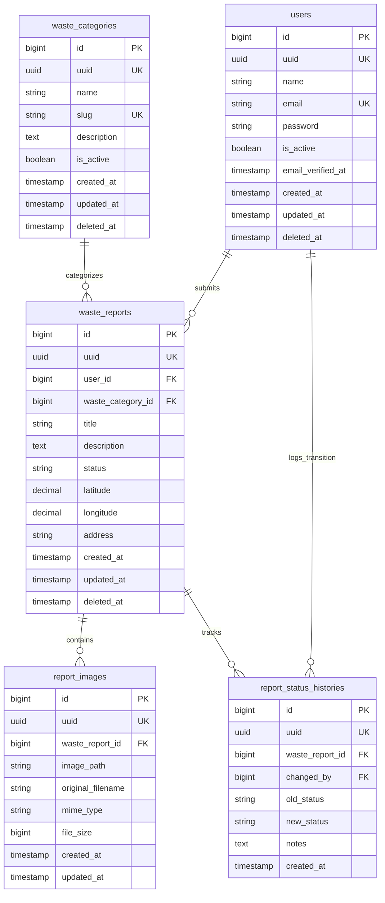
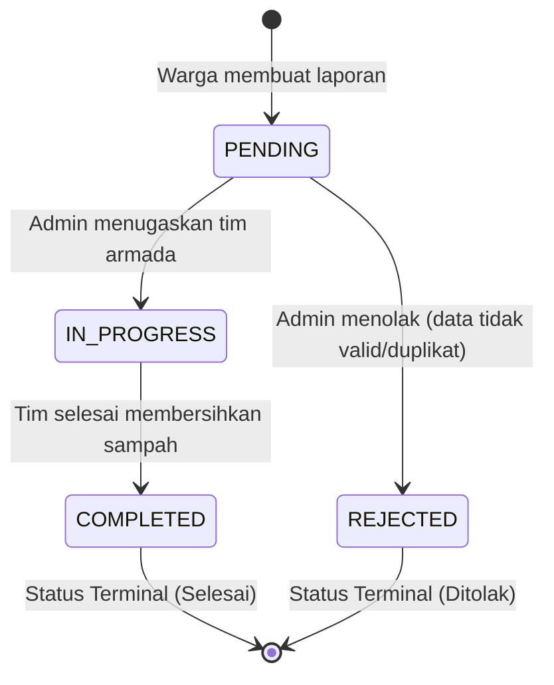

# DOKUMENTASI SISTEM PENGELOLAAN SAMPAH PINTAR
## (Smart Waste Management System)

---

## DAFTAR ISI
1. [Ringkasan Eksekutif & Arsitektur](#1-ringkasan-eksekutif--arsitektur)
2. [Spesifikasi Teknologi & Kebutuhan Sistem](#2-spesifikasi-teknologi--kebutuhan-sistem)
3. [Kronologi & Tahapan Pengembangan (Phase 1 - 6)](#3-kronologi--tahapan-pengembangan)
4. [Struktur Folder & Desain Database](#4-struktur-folder--desain-database)
5. [Spesifikasi API & State Machine Laporan](#5-spesifikasi-api--state-machine-laporan)
6. [Panduan Instalasi & Menjalankan Aplikasi](#6-panduan-instalasi--menjalankan-aplikasi)
7. [Akun Bawaan (Default Credentials)](#7-akun-bawaan-default-credentials)
8. [Panduan Pengujian (Testing)](#8-panduan-pengujian-testing)
9. [Panduan Pemeliharaan & Operasional (Maintenance)](#9-panduan-pemeliharaan--operasional-maintenance)
10. [Troubleshooting & Solusi Masalah Umum](#10-troubleshooting--solusi-masalah-umum)

---

## 1. RINGKASAN EKSEKUTIF & ARSITEKTUR

**Smart Waste Management System** adalah platform web modern berbasis komunitas untuk memantau, melaporkan, mengklasifikasi, dan menyelesaikan tumpukan/masalah sampah secara *real-time*.

Aplikasi ini dibangun menggunakan arsitektur **Modular Monolith** dengan pemisahan tegas antara:
- **Backend API**: REST API berbasis **Laravel 12** (`/api/v1`) yang menerapkan prinsip *Clean Architecture* (Service Layer, Data Transfer Objects/DTO, Form Request Validation, Eloquent API Resources, dan Policy-based Authorization).
- **Frontend SPA**: Single Page Application (SPA) berbasis **Vue 3**, **TypeScript**, dan **Vite** dengan styling utilitas modern **Tailwind CSS v4**.

```
+--------------------------------------------------------------------------+
|                          VUE 3 SPA (FRONTEND)                            |
|    Pinia Store | TanStack Vue Query | Leaflet OSM | ApexCharts           |
+--------------------------------------------------------------------------+
                                    |
                         JSON REST API (/api/v1)
                    Bearer Token / X-Request-ID Header
                                    v
+--------------------------------------------------------------------------+
|                         LARAVEL 12 (BACKEND API)                         |
|  Controllers -> Requests (Validation) -> Services (Business Logic)       |
|  Policies (Authorization) -> DTOs -> Resources (Envelope Transformer)    |
+--------------------------------------------------------------------------+
                                    |
                           Internal BIGINT Keys
                                    v
+--------------------------------------------------------------------------+
|                         POSTGRESQL DATABASE                              |
|   users | waste_categories | waste_reports | report_status_histories     |
+--------------------------------------------------------------------------+
```

### Prinsip Desain Kunci
1. **Pemisahan Identitas BIGINT vs UUID Publik**: Seluruh tabel bisnis menggunakan internal primary key `BIGINT` untuk kecepatan indexing relasi database, namun API dan Frontend **hanya mengekspos `UUID`**. Nilai ID integer internal tidak pernah dibocorkan ke publik.
2. **Standardized API Response Envelope**: Seluruh output API dibungkus seragam dengan atribut `success`, `message`, `data`, `meta` (`request_id` dan `timestamp`), serta header `X-Request-ID`.
3. **Authorization Berlapis di Backend**: Proteksi akses tidak hanya ada di router Vue, tetapi mutlak dieksekusi di backend melalui **Laravel Policies** dan **Spatie Permission**.
4. **State Machine yang Ketat**: Transisi status laporan sampah diverifikasi secara deterministik dengan pencatatan riwayat audit (*status history*) yang bersifat *append-only*.

---

## 2. SPESIFIKASI TEKNOLOGI & KEBUTUHAN SISTEM

### Backend Stack
- **Framework**: Laravel 12
- **Bahasa**: PHP 8.3+ (menggunakan binary `C:\laragon\bin\php\php-8.3.28-Win32-vs16-x64\php.exe`)
- **Database Engine**: PostgreSQL 16+ (Port 5432, Database: `smart_waste_management`)
- **Autentikasi API**: Laravel Sanctum (Personal Access Token)
- **Role & Permission**: Spatie Laravel Permission
- **Code Formatter**: Laravel Pint (PSR-12 / Laravel Standards)
- **Testing Framework**: PHPUnit 11

### Frontend Stack
- **Framework**: Vue 3.5 (Composition API dengan `<script setup lang="ts">`)
- **Bahasa**: TypeScript 5.8+ & `vue-tsc`
- **Build Tool**: Vite 8 & `@tailwindcss/vite`
- **CSS Framework**: Tailwind CSS v4
- **State Management**: Pinia 3+
- **Data Fetching & Cache**: TanStack Vue Query v5
- **HTTP Client**: Axios 1.2+
- **Peta & Geospasial**: Leaflet 1.9 & OpenStreetMap
- **Visualisasi & Grafik**: ApexCharts & Vue3-ApexCharts
- **Date Utility**: Day.js
- **Icon Set**: Lucide Vue Next

---

## 3. KRONOLOGI & TAHAPAN PENGEMBANGAN

Pengembangan diselesaikan secara bertahap melalui 6 fase terstruktur:

### Phase 1: Project Foundation (Fondasi Proyek)
- Inisialisasi proyek Laravel 12 dan konfigurasi lingkungan Laragon.
- Koneksi ke PostgreSQL pada port `5432` (`smart_waste_management`).
- Instalasi dependensi inti: `laravel/sanctum`, `spatie/laravel-permission`, `laravel/boost`.
- Konfigurasi bundler Vite, Tailwind CSS v4, Vue 3, Vue Router, Pinia, dan TanStack Vue Query.
- Implementasi middleware `RequestIdMiddleware` untuk menyematkan `X-Request-ID` unik di setiap siklus request-response.
- Pembuatan trait `ApiResponse` dan penanganan exception global di `bootstrap/app.php`.

### Phase 2: Database & Authentication (Basis Data & Autentikasi)
- Pembuatan skema migrasi tabel PostgreSQL lengkap dengan audit timestamp dan soft deletes.
- Pembuatan Enum `UserRole` (`admin`, `user`) dan `ReportStatus` (`PENDING`, `IN_PROGRESS`, `COMPLETED`, `REJECTED`).
- Pembuatan trait `HasUuid` dan `HasAudit`.
- Seeding Role dan Permission standar aplikasi.
- Pembuatan modul autentikasi REST API:
  - `POST /api/v1/auth/register`
  - `POST /api/v1/auth/login`
  - `POST /api/v1/auth/logout`
  - `GET /api/v1/auth/me`
  - `PUT /api/v1/auth/profile`
  - `PUT /api/v1/auth/change-password`
- Pembuatan antarmuka pengguna: Store Pinia `auth.ts`, `LoginView.vue`, `RegisterView.vue`, `ProfileView.vue`, dan *Navigation Guard*.

### Phase 3: Master Data Management (Manajemen Data Master)
- **Waste Categories (Kategori Sampah)**:
  - CRUD Kategori Sampah (Organik, Plastik, Kertas) berbasis DTO dan Form Request.
  - Aturan bisnis: Kategori yang memiliki laporan sampah aktif tidak boleh dihapus (`422 Unprocessable`).
  - Toggle status aktif/nonaktif kategori sampah.
- **User Management (Manajemen Pengguna)**:
  - Pengelolaan pengguna oleh Administrator.
  - Proteksi akun: Administrator tidak dapat menonaktifkan atau menghapus akunnya sendiri.
  - CRUD pengguna lengkap dengan penetapan role Spatie.
- Antarmuka CRUD frontend: `CategoryListView.vue`, `UserListView.vue`, modal interaktif `AppModal.vue`, dan komponen paginasi `AppPagination.vue`.

### Phase 4: Waste Reports Management (Manajemen Laporan Sampah)
- Implementasi alur pelaporan sampah oleh warga (*citizens*):
  - Form penginputan judul, deskripsi, pemilihan kategori via UUID.
  - Komponen geolokasi interaktif `LocationPicker.vue` menggunakan Leaflet dan OpenStreetMap (dukungan GPS Geolocation dan pin koordinat yang dapat digeser/diklik).
  - Validasi multi-upload berkas gambar (JPEG, PNG, WebP maksimal 5MB per berkas).
  - Penyimpanan berkas menggunakan Laravel Public Storage disk (`storage/app/public/reports/{uuid}`).
- Penegakan kebijakan akses (*WasteReportPolicy*):
  - Warga hanya dapat melihat dan mengelola laporannya sendiri.
  - Administrator dapat melihat seluruh laporan komunitas dan mengubah status.
  - Warga **hanya dapat mengubah atau menghapus** laporannya ketika status masih `PENDING`. Begitu laporan berstatus `IN_PROGRESS`, laporan terkunci secara permanen.
- State Machine transisi status:
  - `PENDING` $\rightarrow$ `IN_PROGRESS` atau `REJECTED`
  - `IN_PROGRESS` $\rightarrow$ `COMPLETED`
  - Status `COMPLETED` dan `REJECTED` adalah status akhir (*terminal states*).
- Setiap transisi otomatis mencatat riwayat ke tabel `report_status_histories` bersama nama admin penanggung jawab, catatan tindak lanjut, dan timestamp.
- Antarmuka frontend: `ReportListView.vue`, `CreateReportView.vue`, `ReportDetailView.vue`, `EditReportView.vue`, `LocationViewer.vue`, dan `ReportStatusBadge.vue`.

### Phase 5: Dashboard & Analytics (Dashboard & Visualisasi)
- Implementasi endpoint analitik performa tinggi:
  - `GET /api/v1/dashboard/admin`: Menyajikan total laporan, breakdown status, jumlah pengguna, persentase per kategori, tren laporan 6 bulan terakhir, dan 5 laporan terbaru.
  - `GET /api/v1/dashboard/user`: Menyajikan ringkasan personal warga, status tindak lanjut laporannya, dan riwayat aktivitas pelaporan.
- Agregasi tren bulanan dibuat *database-agnostic* yang berjalan konsisten di SQLite (testing) maupun PostgreSQL (produksi).
- Visualisasi data interaktif pada `DashboardView.vue` menggunakan **ApexCharts**:
  - *Area Chart*: Menampilkan perbandingan laporan masuk vs laporan selesai dalam kurva tren 6 bulan terakhir.
  - *Donut Chart*: Menampilkan distribusi komposisi jenis sampah dengan total akumulasi di bagian tengah donat.
  - Tabel ringkasan insiden terbaru dengan tautan langsung ke detail laporan.

### Phase 6: Testing & Finalization (Pengujian Menyeluruh & Finalisasi)
- Pembuatan skenario pengujian integrasi ujung-ke-ujung (*End-to-End*): [`EndToEndWorkflowTest.php`](file:///c:/laragon/www/smart-waste-management-system/tests/Feature/Api/V1/EndToEndWorkflowTest.php) dengan 34 asersi.
- Total **45 automated tests (351 assertions)** lulus 100% tanpa kegagalan.
- Pembuatan seeder demo realistis: [`DemoWasteReportSeeder.php`](file:///c:/laragon/www/smart-waste-management-system/database/seeders/DemoWasteReportSeeder.php).
- Format kode otomatis melalui Laravel Pint (0 pelanggaran gaya kode).
- Verifikasi kompilasi frontend Vite (0 warning/error).
- Verifikasi *Route Caching* dan *Config Caching*.

---

## 4. STRUKTUR FOLDER & DESAIN DATABASE

### Struktur Folder Backend (Laravel 12)
```
app/
├── DTOs/                        # Data Transfer Objects
│   ├── Auth/
│   ├── Categories/
│   ├── Reports/
│   └── Users/
├── Enums/                       # Native PHP Enums
│   ├── ReportStatus.php         # Pending, InProgress, Completed, Rejected
│   └── UserRole.php             # Admin, User
├── Http/
│   ├── Controllers/Api/V1/      # REST API Controllers (V1)
│   ├── Middleware/              # RequestIdMiddleware
│   ├── Requests/                # Form Request Validations
│   └── Resources/               # API Resource Transformers (UUID only)
├── Models/                      # Eloquent Models
│   ├── Concerns/                # HasUuid, HasAudit traits
│   ├── ReportImage.php
│   ├── ReportStatusHistory.php
│   ├── User.php
│   ├── WasteCategory.php
│   └── WasteReport.php
├── Policies/                    # Authorization Policies
│   ├── UserPolicy.php
│   ├── WasteCategoryPolicy.php
│   └── WasteReportPolicy.php
├── Services/                    # Layer Logika Bisnis
│   ├── AuthService.php
│   ├── DashboardService.php
│   ├── UserService.php
│   ├── WasteCategoryService.php
│   └── WasteReportService.php
└── Support/                     # ApiResponse Trait
```

### Struktur Folder Frontend (Vue 3 SPA)
```
resources/js/
├── components/
│   ├── maps/                    # LocationPicker.vue, LocationViewer.vue
│   └── ui/                      # AppModal, AppPagination, ImageUpload, ReportStatusBadge
├── layouts/                     # AppLayout.vue, AuthLayout.vue
├── modules/
│   ├── auth/                    # LoginView.vue, RegisterView.vue
│   ├── categories/              # CategoryListView.vue
│   ├── dashboard/               # DashboardView.vue (ApexCharts)
│   ├── profile/                 # ProfileView.vue
│   ├── reports/                 # ReportListView, CreateReport, ReportDetail, EditReport
│   └── users/                   # UserListView.vue
├── router/                      # index.ts (Guards & Meta Titles)
├── services/                    # Axios API Wrappers (api, auth, category, report, dashboard)
├── stores/                      # Pinia Stores (auth.ts)
├── types/                       # TypeScript Interface Definitions
├── views/                       # HomeView.vue, NotFoundView.vue
└── app.ts                       # Entry Point Aplikasi
```

### Desain Tabel Basis Data (PostgreSQL)



---

## 5. SPESIFIKASI API & STATE MACHINE LAPORAN

### Standard Response Envelope

#### Sukses Tunggal:
```json
{
  "success": true,
  "message": "Waste report retrieved successfully",
  "data": {
    "uuid": "0f81d1ef-19bb-4c22-b25f-f06b12d5d852",
    "title": "Tumpukan Sampah Plastik",
    "status": "PENDING"
  },
  "meta": {
    "request_id": "7b0d1822-0487-4aa7-b50a-b153e7f91ff3",
    "timestamp": "2026-11-02T19:40:00+07:00"
  },
  "errors": null
}
```

#### Sukses Terpaginasi:
```json
{
  "success": true,
  "message": "Data retrieved successfully",
  "data": [ ... ],
  "meta": {
    "current_page": 1,
    "last_page": 5,
    "per_page": 10,
    "total": 48,
    "from": 1,
    "to": 10,
    "has_next": true,
    "has_previous": false,
    "request_id": "7b0d1822-0487-4aa7-b50a-b153e7f91ff3",
    "timestamp": "2026-11-02T19:40:00+07:00"
  },
  "errors": null
}
```

#### Kesalahan Validasi (HTTP 422):
```json
{
  "success": false,
  "message": "The category uuid field is required.",
  "data": null,
  "meta": {
    "request_id": "97e682d3-9bc0-4e3a-b8cb-4752c086111f",
    "timestamp": "2026-11-02T19:40:00+07:00"
  },
  "errors": {
    "category_uuid": [
      "The category uuid field is required."
    ]
  }
}
```

### State Machine Transisi Status Laporan Sampah



- Laporan yang baru dibuat selalu bernilai `PENDING`.
- Warga **hanya dapat mengedit atau menghapus** laporannya ketika masih berada di fase `PENDING`.
- Begitu status berubah menjadi `IN_PROGRESS`, laporan **terkunci permanen** bagi pembuat laporan untuk menjaga integritas bukti lapangan.
- Status `COMPLETED` dan `REJECTED` bersifat final dan tidak dapat diubah kembali.

### Ringkasan Endpoint API (`/api/v1`)

| Method | Endpoint | Hak Akses | Deskripsi |
| :--- | :--- | :--- | :--- |
| `POST` | `/api/v1/auth/register` | Publik | Pendaftaran akun warga |
| `POST` | `/api/v1/auth/login` | Publik | Otentikasi & pengembalian token Sanctum |
| `POST` | `/api/v1/auth/logout` | Terotentikasi | Pencabutan token sesi aktif |
| `GET` | `/api/v1/auth/me` | Terotentikasi | Informasi profil pengguna yang sedang login |
| `PUT` | `/api/v1/auth/profile` | Terotentikasi | Pembaruan nama/profil |
| `PUT` | `/api/v1/auth/change-password` | Terotentikasi | Penggantian kata sandi |
| `GET` | `/api/v1/dashboard/admin` | Admin | Ringkasan metrik & analitik sistem |
| `GET` | `/api/v1/dashboard/user` | User / Admin | Ringkasan metrik pribadi warga |
| `GET` | `/api/v1/categories` | Publik | Daftar kategori sampah aktif |
| `POST` | `/api/v1/categories` | Admin | Menambah kategori sampah baru |
| `GET` | `/api/v1/categories/{uuid}` | Publik | Detail kategori sampah |
| `PUT` | `/api/v1/categories/{uuid}` | Admin | Memperbarui data kategori sampah |
| `PATCH` | `/api/v1/categories/{uuid}/status` | Admin | Toggle aktif/nonaktif kategori |
| `DELETE` | `/api/v1/categories/{uuid}` | Admin | Hapus kategori (ditolak jika memiliki laporan) |
| `GET` | `/api/v1/reports` | Terotentikasi | Daftar laporan (Admin: semua; User: milik sendiri) |
| `POST` | `/api/v1/reports` | Terotentikasi | Membuat laporan sampah (termasuk upload gambar & koordinat) |
| `GET` | `/api/v1/reports/{uuid}` | Terotentikasi | Detail laporan sampah |
| `PUT` | `/api/v1/reports/{uuid}` | Pembuat (Pending) / Admin | Memperbarui laporan sampah |
| `DELETE` | `/api/v1/reports/{uuid}` | Pembuat (Pending) / Admin | Menghapus laporan sampah |
| `PATCH` | `/api/v1/reports/{uuid}/status` | Admin | Memperbarui status laporan & mencatat riwayat |
| `GET` | `/api/v1/reports/{uuid}/history` | Terotentikasi | Riwayat audit kronologis status laporan |
| `POST` | `/api/v1/reports/{uuid}/images` | Terotentikasi | Menambahkan foto tambahan ke laporan |
| `DELETE` | `/api/v1/reports/{uuid}/images/{imgUuid}` | Terotentikasi | Menghapus foto dari laporan |
| `GET` | `/api/v1/users` | Admin | Daftar pengguna terpaginasi |
| `POST` | `/api/v1/users` | Admin | Menambah akun pengguna baru |
| `GET` | `/api/v1/users/{uuid}` | Admin | Detail akun pengguna |
| `PUT` | `/api/v1/users/{uuid}` | Admin | Memperbarui akun pengguna |
| `PATCH` | `/api/v1/users/{uuid}/status` | Admin | Toggle aktif/nonaktif pengguna |
| `DELETE` | `/api/v1/users/{uuid}` | Admin | Menghapus pengguna (dicegah jika akun sendiri) |

---

## 6. PANDUAN INSTALASI & MENJALANKAN APLIKASI

### Prasyarat Komputer
1. **Laragon** dengan PHP versi 8.3+ terpasang (`C:\laragon\bin\php\php-8.3.28-Win32-vs16-x64\php.exe`).
2. **PostgreSQL** berjalan di `127.0.0.1:5432` dengan database `smart_waste_management`.
3. **Node.js** v20+ dan NPM (`npm.cmd` di lingkungan Windows PowerShell).
4. **Composer** v2+.

### Langkah-langkah Instalasi

#### 1. Masuk ke Direktori Proyek
```powershell
cd C:\laragon\www\smart-waste-management-system
```

#### 2. Konfigurasi Environment File (`.env`)
Pastikan variabel lingkungan pada `.env` sudah sesuai:
```env
APP_NAME="Smart Waste Management"
APP_ENV=local
APP_KEY=base64:...
APP_DEBUG=true
APP_URL=http://localhost:8000

DB_CONNECTION=pgsql
DB_HOST=127.0.0.1
DB_PORT=5432
DB_DATABASE=smart_waste_management
DB_USERNAME=postgres
DB_PASSWORD=postgres

FILESYSTEM_DISK=public
```

#### 3. Instalasi Dependensi Backend (PHP)
```powershell
& "C:\laragon\bin\php\php-8.3.28-Win32-vs16-x64\php.exe" C:\laragon\bin\composer\composer.phar install
```

#### 4. Instalasi Dependensi Frontend (JavaScript/TypeScript)
```powershell
npm.cmd install
```

#### 5. Generate Application Key (Jika Belum Ada)
```powershell
& "C:\laragon\bin\php\php-8.3.28-Win32-vs16-x64\php.exe" artisan key:generate
```

#### 6. Hubungkan Storage Link (Public Disk)
```powershell
& "C:\laragon\bin\php\php-8.3.28-Win32-vs16-x64\php.exe" artisan storage:link
```

#### 7. Jalankan Migrasi dan Database Seeder
```powershell
& "C:\laragon\bin\php\php-8.3.28-Win32-vs16-x64\php.exe" artisan migrate:fresh --seed
```

#### 8. Menjalankan Aplikasi

##### Mode Pengembangan (Development)
Jalankan backend dan frontend di terminal terpisah:
- **Terminal 1 (Backend API)**:
  ```powershell
  & "C:\laragon\bin\php\php-8.3.28-Win32-vs16-x64\php.exe" artisan serve
  ```
  *(Aplikasi berjalan di `http://127.0.0.1:8000`)*

- **Terminal 2 (Frontend Vite)**:
  ```powershell
  npm.cmd run dev
  ```

##### Mode Produksi (Production Build)
Lakukan kompilasi bundle frontend ke direktori `public/build`:
```powershell
npm.cmd run build
```
Setelah di-build, seluruh halaman SPA akan disajikan langsung oleh web server Laravel/Laragon tanpa memerlukan proses dev server Vite.

---

## 7. AKUN BAWAAN (DEFAULT CREDENTIALS)

Database telah disuntikkan (*seeded*) dengan akun bawaan untuk pengujian:

| Role | Email | Password | Kegunaan |
| :--- | :--- | :--- | :--- |
| **Administrator** | `admin@waste.local` | `Admin@123456` | Akses penuh: manajemen pengguna, kategori, transisi status laporan, analitik sistem. |
| **Warga (Citizen)** | `user@waste.local` | `Password@123` | Akses warga: membuat laporan, memilih koordinat peta, mengunggah foto, memantau riwayat personal. |

---

## 8. PANDUAN PENGUJIAN (TESTING)

Aplikasi memiliki rangkaian pengujian otomatis lengkap menggunakan PHPUnit.

### Menjalankan Seluruh Automated Test Suite
```powershell
& "C:\laragon\bin\php\php-8.3.28-Win32-vs16-x64\php.exe" artisan test --compact
```
**Hasil yang diharapkan**: `45 passed (351 assertions)`.

### Menjalankan Pengujian per Modul

- **Pengujian Alur End-to-End**:
  ```powershell
  & "C:\laragon\bin\php\php-8.3.28-Win32-vs16-x64\php.exe" artisan test --filter=EndToEndWorkflowTest --compact
  ```
- **Pengujian Laporan Sampah (Waste Reports)**:
  ```powershell
  & "C:\laragon\bin\php\php-8.3.28-Win32-vs16-x64\php.exe" artisan test --filter=WasteReportTest --compact
  ```
- **Pengujian Dashboard & Analitik**:
  ```powershell
  & "C:\laragon\bin\php\php-8.3.28-Win32-vs16-x64\php.exe" artisan test --filter=DashboardTest --compact
  ```
- **Pengujian Autentikasi**:
  ```powershell
  & "C:\laragon\bin\php\php-8.3.28-Win32-vs16-x64\php.exe" artisan test --filter=AuthTest --compact
  ```
- **Pengujian Kategori Sampah**:
  ```powershell
  & "C:\laragon\bin\php\php-8.3.28-Win32-vs16-x64\php.exe" artisan test --filter=WasteCategoryTest --compact
  ```
- **Pengujian Manajemen Pengguna**:
  ```powershell
  & "C:\laragon\bin\php\php-8.3.28-Win32-vs16-x64\php.exe" artisan test --filter=UserManagementTest --compact
  ```

### Memeriksa Kepatuhan Format Kode (Linter / Pint)
```powershell
& "C:\laragon\bin\php\php-8.3.28-Win32-vs16-x64\php.exe" vendor/bin/pint --format agent
```

---

## 9. PANDUAN PEMELIHARAAN & OPERASIONAL (MAINTENANCE)

### 1. Backup Basis Data PostgreSQL
Lakukan pencadangan (*dump*) secara berkala:
```powershell
# Backup database ke file SQL
pg_dump -h 127.0.0.1 -p 5432 -U postgres -d smart_waste_management -F c -b -v -f "C:\backup\smart_waste_management_$(Get-Date -Format 'yyyyMMdd_HHmmss').dump"
```

### 2. Restore Basis Data PostgreSQL
Jika terjadi kegagalan data atau migrasi server:
```powershell
# Restore database dari file dump
pg_restore -h 127.0.0.1 -p 5432 -U postgres -d smart_waste_management -v "C:\backup\<nama_file>.dump"
```

### 3. Backup Berkas Media / Foto Laporan
Seluruh gambar lampiran laporan tersimpan di direktori:
```
storage/app/public/reports/
```
Pastikan folder ini masuk ke dalam daftar sinkronisasi cadangan berkala (*cold storage* / AWS S3 / MinIO).

### 4. Manajemen Cache & Optimasi Kinerja Produksi
Saat aplikasi berada di lingkungan *production*, aktifkan *cache* bawaan Laravel untuk performa maksimal:
```powershell
# Mengaktifkan Cache Routing & Konfigurasi
& "C:\laragon\bin\php\php-8.3.28-Win32-vs16-x64\php.exe" artisan config:cache
& "C:\laragon\bin\php\php-8.3.28-Win32-vs16-x64\php.exe" artisan route:cache
& "C:\laragon\bin\php\php-8.3.28-Win32-vs16-x64\php.exe" artisan view:cache

# Membersihkan Cache Saat Terjadi Perubahan Konfigurasi
& "C:\laragon\bin\php\php-8.3.28-Win32-vs16-x64\php.exe" artisan config:clear
& "C:\laragon\bin\php\php-8.3.28-Win32-vs16-x64\php.exe" artisan route:clear
& "C:\laragon\bin\php\php-8.3.28-Win32-vs16-x64\php.exe" artisan view:clear
```

### 5. Pemantauan Log Aplikasi (Monitoring)
Berkas log aplikasi Laravel tersimpan di:
```
storage/logs/laravel.log
```
Gunakan perintah berikut untuk memantau error secara langsung (*live tail*):
```powershell
Get-Content -Path storage\logs\laravel.log -Wait -Tail 50
```

### 6. Rotasi Log Berkala
Pastikan konfigurasi `config/logging.php` menggunakan driver `daily` agar ukuran berkas log tidak membebani kapasitas disk penyimpanan server:
```env
LOG_CHANNEL=daily
LOG_LEVEL=debug
```

### 7. Pembaruan Dependensi (Package Updates)
Lakukan audit keamanan dependensi secara berkala:
```powershell
# Audit dependensi PHP
& "C:\laragon\bin\php\php-8.3.28-Win32-vs16-x64\php.exe" C:\laragon\bin\composer\composer.phar audit

# Audit dependensi NPM
npm.cmd audit
```

---

## 10. TROUBLESHOOTING & SOLUSI MASALAH UMUM

### 1. Masalah: `PSSecurityException` saat Menjalankan Perintah NPM
- **Penyebab**: Kebijakan eksekusi PowerShell di Windows memblokir file script `npm.ps1`.
- **Solusi**: Selalu gunakan perintah `npm.cmd` alih-alih `npm` biasa, contoh:
  ```powershell
  npm.cmd run build
  ```

### 2. Masalah: Versi PHP Global Sistem Berbeda dengan Laragon
- **Penyebab**: Path default environment Windows mengarah ke PHP 8.0, sedangkan proyek mensyaratkan PHP 8.3+.
- **Solusi**: Selalu jalankan Artisan menggunakan path binary PHP 8.3 Laragon secara eksplisit:
  ```powershell
  & "C:\laragon\bin\php\php-8.3.28-Win32-vs16-x64\php.exe" artisan <perintah>
  ```

### 3. Masalah: Ikon Marker Leaflet Tidak Tampil di Peta
- **Penyebab**: Bundler Vite mengubah nama aset gambar leaflet default (*cache-busting hash*), sehingga path gambar default Leaflet mengarah ke 404.
- **Solusi**: Sudah diatasi secara permanen di [`LocationPicker.vue`](file:///c:/laragon/www/smart-waste-management-system/resources/js/components/maps/LocationPicker.vue) dan [`LocationViewer.vue`](file:///c:/laragon/www/smart-waste-management-system/resources/js/components/maps/LocationViewer.vue) melalui pemetaan modul aset eksplisit:
  ```ts
  import markerIcon2x from 'leaflet/dist/images/marker-icon-2x.png';
  import markerIcon from 'leaflet/dist/images/marker-icon.png';
  import markerShadow from 'leaflet/dist/images/marker-shadow.png';

  L.Icon.Default.mergeOptions({
    iconRetinaUrl: markerIcon2x,
    iconUrl: markerIcon,
    shadowUrl: markerShadow,
  });
  ```

### 4. Masalah: Gambar Laporan Mengembalikan Status 404
- **Penyebab**: Tautan simbolik (*symlink*) `public/storage` belum terhubung ke `storage/app/public`.
- **Solusi**: Jalankan kembali perintah pembuatan symlink:
  ```powershell
  & "C:\laragon\bin\php\php-8.3.28-Win32-vs16-x64\php.exe" artisan storage:link
  ```

### 5. Masalah: Koneksi Basis Data PostgreSQL Ditolak
- **Penyebab**: Service PostgreSQL belum aktif atau password di `.env` tidak sesuai.
- **Solusi**:
  1. Pastikan PostgreSQL aktif di Laragon atau Windows Services (`services.msc` $\rightarrow$ `postgresql-x64-16`).
  2. Uji koneksi dengan perintah terminal:
     ```powershell
     & "C:\laragon\bin\php\php-8.3.28-Win32-vs16-x64\php.exe" artisan db:show
     ```

---
*Dokumentasi ini disusun dan diverifikasi pada tanggal 2 November 2026 sebagai panduan resmi pengembangan dan pemeliharaan Smart Waste Management System.*

